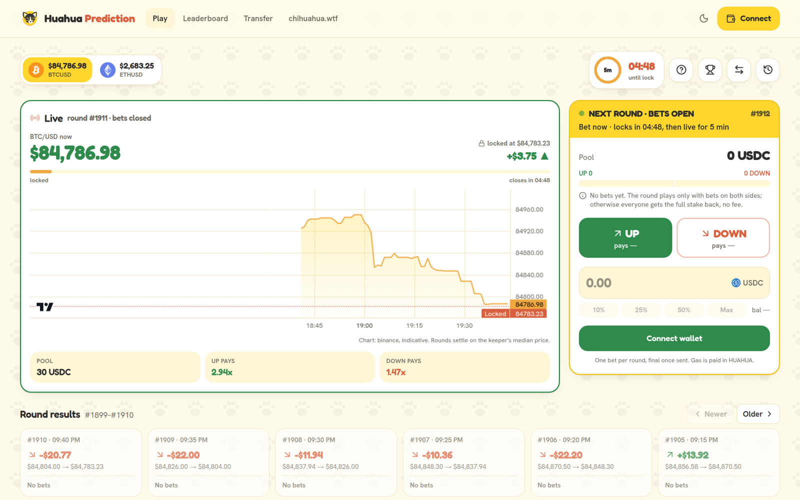
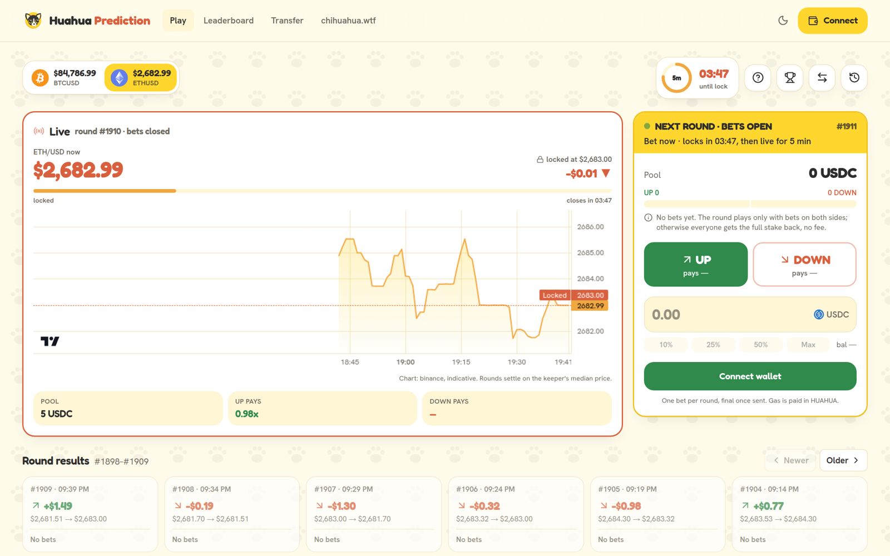
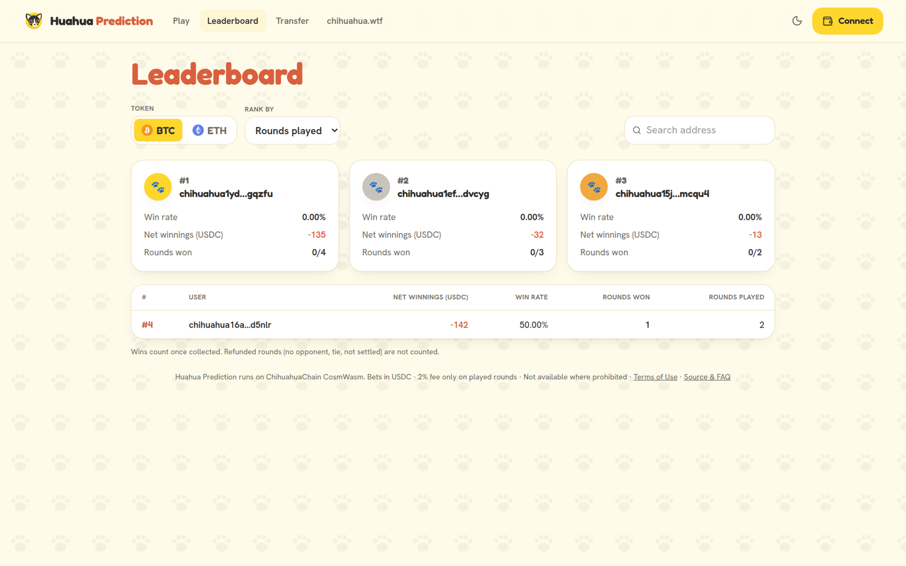
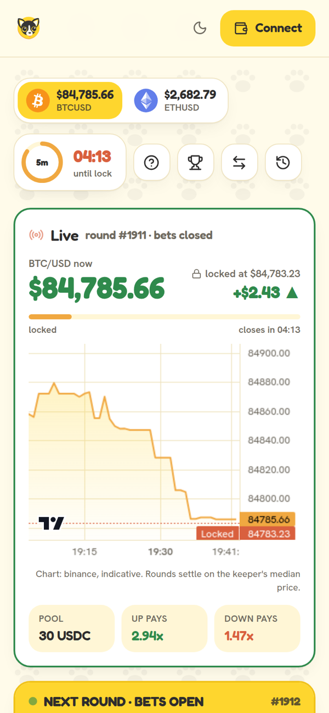
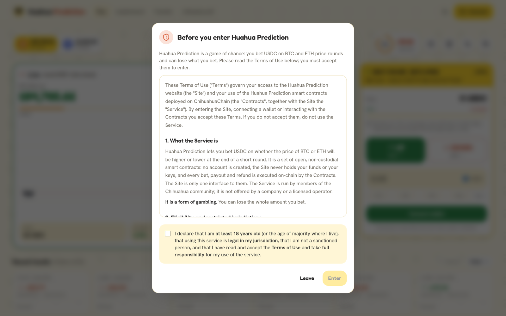

<p align="center">
  
</p>

<h1 align="center">Huahua Prediction</h1>

<p align="center">
  <b>Up or down? Five-minute BTC and ETH price rounds on Chihuahua Chain, paid in USDC.</b><br />
  Pick a side, the winners split the pot. Non-custodial, settled by a CosmWasm contract, 2% fee only on rounds actually played.
</p>

<p align="center">
  <a href="https://predict.chihuahua.wtf"><b>Play</b></a> ·
  <a href="FAQ.md"><b>FAQ</b></a> ·
  <a href="https://predict.chihuahua.wtf/#/terms"><b>Terms of Use</b></a> ·
  <a href="https://github.com/ChihuahuaChain/huallet"><b>Huallet</b></a> ·
  <a href="https://chihuahua.wtf"><b>chihuahua.wtf</b></a>
</p>

<p align="center">
  
</p>

---

## How it works

| | |
|---|---|
| **1 · Bring USDC** | Swap to USDC.inj on Osmosis (Noble USDC swaps 1:1), then move it to Chihuahua from the *Transfer* page. Keep a few HUAHUA for gas. |
| **2 · Pick a side** | Bet UP or DOWN on the next round of BTC or ETH, from 1 USDC. The multipliers show what each side pays right now. |
| **3 · Watch it play** | The round locks at the current price and closes 5 minutes later. Higher close: UP wins. Lower: DOWN wins. |
| **4 · Collect** | Winners split the pot minus 2%. Ties, one-sided rounds and missed settlements are refunded in full, no fee. |

<p align="center">
  
  
</p>

## Why it's fair

- **Non-custodial.** Bets sit in the contract, not with an operator. Payouts are pulled by the winner with `Claim`, and nothing expires.
- **Only played rounds pay a fee.** Ties, rounds with bets on one side only and rounds the keeper misses are refunded in full.
- **One currency.** The contract takes only USDC.inj; the denom is fixed at instantiation and cannot be changed.
- **Transparent prices.** Seven public exchanges (Binance, Coinbase, Kraken, Bitstamp, OKX, Bybit, Gemini), outliers beyond 0.5% dropped, median of at least three, recorded on-chain with every round. Stale prices are rejected by the contract.
- **Verifiable code.** The contract in this repository builds reproducibly to the exact bytes deployed on chain (see below).

<p align="center">
  
  
</p>

## Wallets

[Huallet](https://github.com/ChihuahuaChain/huallet) (browser extension) and Keplr. Deposits are signed on Osmosis (gas in OSMO), bets and withdrawals on Chihuahua (gas in HUAHUA, about 12 HUAHUA per bet).

## The contract

`contracts/prediction` is a CosmWasm 2 contract; one instance per market, same code.

| Message | Who | What |
|---|---|---|
| `BetBull { epoch }` / `BetBear { epoch }` | anyone | bet the attached USDC on the open round |
| `Claim { epochs }` | anyone | collect winnings and refunds |
| `GenesisStartRound`, `GenesisLockRound`, `ExecuteRound` | operator | push the price and move rounds forward |
| `Pause`, `Unpause` | admin, operator | stop or restart rounds (bets already placed stay claimable) |
| `UpdateConfig`, `SetOperator`, `ProposeAdmin` / `AcceptAdmin` | admin | round length, minimum bet, fee, treasury, keys |
| `ClaimTreasury` | admin | send the accrued fee to the treasury |

Payout: `bet × (pool − fee) ÷ winning side`, fee = `fee_bps` (200) of the pool of a played round.

| | Mainnet (`chihuahua-1`) |
|---|---|
| BTC market | [`chihuahua1awemkjhemtguexmqpatmtw3qrwn5avzd48e453cykzh45gswzwpqzrwgv7`](https://www.mintscan.io/chihuahua/wasm/contract/chihuahua1awemkjhemtguexmqpatmtw3qrwn5avzd48e453cykzh45gswzwpqzrwgv7) |
| ETH market | [`chihuahua1uwl7y5u2jmc78xklg2pvpryjngqfgrx6tc97suuhqekcqwpcnfdqpng24z`](https://www.mintscan.io/chihuahua/wasm/contract/chihuahua1uwl7y5u2jmc78xklg2pvpryjngqfgrx6tc97suuhqekcqwpcnfdqpng24z) |
| Code id | `689` |
| Admin and treasury | Chihuahua ecosystem fund `chihuahua14fketv99hlrlk80mkggw643spsj3yyf7qylvqn` |
| Operator (keeper) | `chihuahua12t4mccyf6mjng20pqdpgkwy8tvx030q57fe48d` |
| Bet denom | `ibc/2CAD00F0570FC6068204B0F4DB49B5752ABEC73B8604693C528B0D9A4417A4D1` (USDC.inj via Osmosis) |

### Build and verify

```sh
cargo test                       # 13 contract tests
./scripts/build_wasm.sh          # cosmwasm/optimizer 0.17.0 + cosmwasm-check
cat artifacts/checksums.txt      # 175d1ee1e322ac949b5e7322808e19d475b4990f0ce488a00207061cc467f932
chihuahuad q wasm code-info 689 --node https://rpc.chihuahua.wtf:443   # data_hash must match
```

## Play responsibly

Betting on price movements is gambling. It is restricted or prohibited in many places: check the law where you live, you must be 18+, and only bet what you can afford to lose. Read the [Terms of Use](https://predict.chihuahua.wtf/#/terms) and the [FAQ](FAQ.md).

<p align="center"><sub>Built by the Chihuahua community · 🐾</sub></p>
